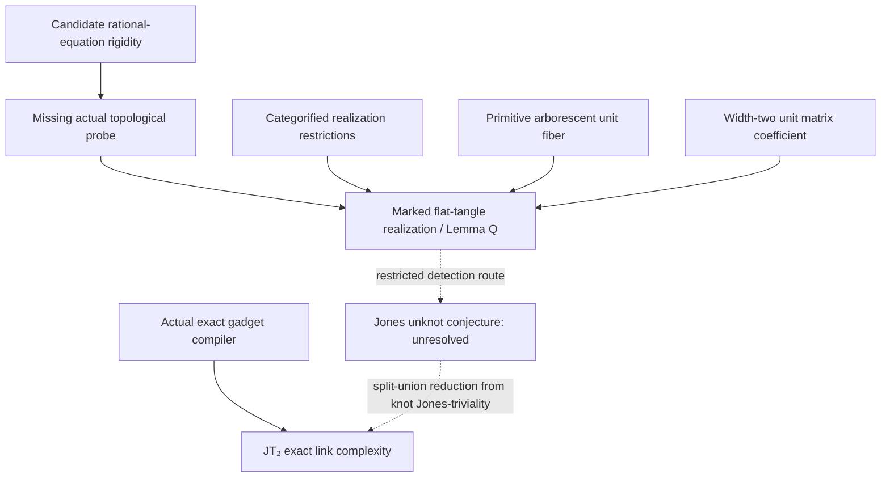

# Research map: what was built, and where it stops

[Start here](START_HERE.md) · [Small results](SMALL_RESULTS.md) · [Failures](FAILURES.md) · [Open problems](OPEN_PROBLEMS.md)

The project repeatedly changed scale. It began with concrete proof audits and knot constructions, moved to tangle and surgery reductions, then to representation theory and categorification, and finally to exact counting gadgets. The persistent issue was **realization**: algebraic data that look like the unknot need not provide the topological information required to recognize it.

This map records the final scope of each route. The original chronological accounts are retained in the [early handoff](../archive/outputs/claude-handoff/CLAUDE_JONES_HANDOFF.txt) and [later theory log](../archive/collab/THEORY-width-ladder.md).

## 1. The first rounds: make proposed mechanisms exact

**Period:** 31 October–2 November. **Entry points:** [early ledger](../archive/work/handoff/early-ledger.txt), [middle ledger](../archive/work/handoff/middle-ledger.txt), [late ledger](../archive/work/handoff/late-ledger.txt).

The first rounds tested several ways one might turn a unit Jones polynomial into trivial topology: twist compression, band fusion of Jones-trivial links, positivity, braid kernels, finite root tests, satellite operators, and control of homological rank or exterior volume. Most results in these ledgers are small deductions or exclusions of a precisely specified construction.

Three distinctions emerged.

* **Finite invariant data are not complete data.** Actual knots can evade a prescribed finite collection of roots or finite Taylor jets. Formal higher-color sequences can pass many algebraic checks without being knot invariants.
* **A scalar is not an operator.** A single closure value does not recover the braid operator, a second closure, higher colors, or the knot exterior. The relevant “promotion” step remained open even when the proposed endpoint theorem was correct.
* **A linear skein construction is not a diagram construction.** Projectors, subtraction, division by the loop value and signed sums are legitimate algebraic operations. Their realization by actual uncolored tangles is a separate question.

The early ledger contains exact family exclusions, not just negative impressions. Examples include one- and two-band recurrences, a classification of units in the two-strand skein algebra, fixed-template twist loci, restrictions on EKT band fusions, and explicit Jones collisions separating higher colors. The [small-results guide](SMALL_RESULTS.md) develops several of the reusable deductions; the ledger preserves the remaining statements and their individual proof paths.

## 2. Rational tangle equations and the missing second topological probe

**Main nodes:** LATE-41, RB-HOM3, RB-3PROBE, RB-ARITH. **Sources:** [audited framed proof](../archive/outputs/rational-tangle-uniqueness-audited-proof.txt), [audit](../archive/collab/audits/LATE-41-audit.md), [unframed extension](../archive/work/big_reductions/surgery.md).

Sikora's conjecture concerns uniqueness of a rational solution to two actual framed tangle equations. The candidate argument in this project passes to branched double covers, matches signed filling coefficients, uses Casson–Walker surgery and Floer-simple torsion, and concludes that the cover is a solid torus. The orientation and framing comparison is an essential step, not a removable convention.

The elementary part of the unframed extension is especially transparent: three homology-order measurements determine an integral peripheral linear functional up to sign. This leads, conditional on the audited surgery-rigidity argument, to two actual closure equalities plus one additional determinant equality. Two unframed closures alone are insufficient; the Ernst–Sumners example supplies the calibration.

**Where the Jones route stops:** polynomial equality supplies scalar information, but not the second actual lens-space filling. The paper cannot be used to replace “isotopic closures” by “closures with equal Jones polynomials.” The manuscript remains an internally audited candidate, with external review and priority unresolved.

## 3. Lemma Q, strong inversions and the November 3 global-design round

**Entry points:** [scaffold](../archive/collab/SCAFFOLD.md), [global routes](../archive/work/global_design/routes.md), [theory log, morning of November 3](../archive/collab/THEORY-width-ladder.md).

An actual unknot closure identifies the other tangle filling problem with surgery on a strongly invertible covering knot. “Flatness” means the relevant bracket coefficient vanishes, making a specified twist family Jones-unit. The project sought a theorem forcing a flat tangle with an unknot closure to be rational or nugatory.

Equivalent or closely related marked formulations used crossing-circle links, Sakuma links, Brunnian theta-curves, annular patterns and pants surfaces. These reformulations clarify the geometry but do not independently solve the realization problem. A necessary condition such as $a_2=0$, determinant one, or a finite-field fifth-root value is a gate, not a mechanism for producing or excluding every candidate.

The same day explored genus-two Jones representations, Burau pairings, two-twist subgroups, recurrence and AJ ideas, positivity, and finite-order approximations. Restricted orbit theorems survived; global claims did not follow from them. The [failure atlas](FAILURES.md) records the missing imports and the countermodels.

## 4. Designed counterexamples: four routes, no surviving candidate

**Period:** November 3 evening. **Main record:** [counterexample design section of the scaffold](../archive/collab/SCAFFOLD.md), [global-design proof notes](../archive/work/global_design/).

The target changed from proving detection to constructing a nontrivial knot with unit Jones polynomial. Designs were required to come with a reason and an exact decisive calculation.

| Design | Intended mechanism | Outcome and surviving question |
|---|---|---|
| Constant-sum twist templates | Make two twist variables invisible along a diagonal | The unchanged Kanenobu resolution mechanism cannot turn a nonunit seed into a unit. New turnback geometry would be required. |
| H2 fused EKT shell | Use two interacting sites to repair a Jones-trivial link into a knot | The determinant equation has no integer unit solutions. That entire marked family is excluded. |
| Sakuma pilot links | Pass (a_2) and fifth-root gates, then test exact unlink Jones value | Six specified pilots were rejected. The gates were necessary but weak. |
| Genus-two kernel / invariant tensor | Find a topologically nontrivial object in a unit skein fiber | Restricted orbit and signed-square results constrain the design; no actual kernel or counterexample was obtained. |
| EKT fusion and clasp variants | Retain link cancellation while changing component structure | Single-fusion defects and the signed-square corner identity excluded the proposed shells. General seam-changing operations remain a distinct problem. |

There is no “best surviving counterexample” from this round. The correct output is the list of exact exclusions and the residual realization conditions.

## 5. Categorification and the geography of cancellation

**Period:** November 15–16. **Entry points:** [bullet-sum proof](../archive/work/theory_restart/sum_functor_referee.md), [sutured-sequence audit](../archive/work/theory_restart/sutured_sequence_referee.md), [ladder countermodel](../archive/work/theory_restart/surgery_ladder_referee.md).

The invariant $N(T)$ is obtained from the Bar–Natan tangle complex by an augmentation that keeps one crossingless matching. Its graded Euler characteristic recovers the selected scalar information, while its graded dimensions expose cancellation hidden from that scalar. Compatible tangle sums tensor these augmented homologies. This gives genuine factor reductions.

The proposed geographic laws—TILT, OVERHANG, J-TILT, NP, END and a parallelogram bound—tried to force a nonzero Euler coefficient at an extreme grading. Several fitted large datasets. Later actual examples refuted the universal endpoint strategy, and longer special curves invalidated an over-narrow shape model.

There were also useful negative theorems. A bare opposite-parity pair fails the admissible matching condition arising from Daemi's plane-Floer sequence. A suitably shifted two-rung ladder, however, admits a natural higher differential cancelling its extra summands after every additive closure. Changing coefficients to characteristic zero does not eliminate the correctly signed formal ladder. Thus a successful categorical bridge must supply additional **geometric compatibility**, not just ranks, grading shifts or the existence of additive spectral sequences.

The identification of the sutured target and its gradings was corrected during the process. In particular, no general bound $\operatorname{rank}\widehat{HFK}\ge 2g+1$ is retained. These corrections are substantive and remain visible in the ledger.

## 6. Exact transfer systems: two-bridge, necklaces and arborescent boxes

**Period:** November 16–17. **Entry points:** [arbitrary-box skein dictionary](../archive/work/theory_restart/skein_dictionary_arbitrary_boxes.md), [necklace analysis](../archive/work/theory_restart/necklace_extremes_referee.md), [resonance and ideals](../archive/work/theory_restart/arborescent_resonance_divisor.md).

The two-bridge work replaced unsupported pictures by a marked two-dimensional representation and a closed degree-state calculation. Its scope is the specified side-preserving strong inversions; side-exchanging inversions were not silently included. The necklace formula then decomposed a more general marked assembly into two fusion channels, with one common normalization.

This produced restricted non-flatness theorems for horizontal Montesinos-type inversions and vertical arborescent constructions. Exact finite-state and Farkas certificates extended certain listed classes. These are infinite-family theorems within their hypotheses, but not a proof for all arborescent inversions. The list of allowed vectors, root slopes and eligible signatures is part of each statement.

An eventual obstruction to finite class lists led to a more structural invariant: the ideal generated by a box's two integral coordinates. Twists preserve it, and products cannot repair a proper ideal. Pairwise compatibility detects when a product of unimodular states remains unimodular. For the remainder, an exact resonance budget reduces each fixed body's horizontal unit search to at most two twist candidates.

**Where this route stops:** a primitive state can pass the scalar gates and still have the formal unit behavior. The missing theorem is geometric realization in this primitive fiber. A naive superadditive deficit was refuted by an explicit unimodular pair with deficits $4+4\to7$.

## 7. Finite-type theory, the osp symbol and cyclotomic comparison

**Entry points:** [integral finite-type audit](../archive/work/theory_restart/ft_integral_referee.md), [osp Casimir calculation](../archive/work/theory_restart/osp_casimir_exact.md), [third-moment audit](../archive/work/theory_restart/degree3_geometric_identity.md).

Expanding $J$ at $t=-1$ gives an equivariant finite-type series. The integral local model resolves singular-projector concerns, and its straight chord symbol agrees with an $\mathfrak{osp}(1|2)$ Casimir normalization. A separate cyclotomic argument compares the quotient invariant with a fifth-root evaluation of the covering knot's ordinary Jones polynomial.

These are structural results and useful necessary conditions. They are not nonvanishing theorems. Explicit commutator families have arbitrarily large first nonzero moment order while remaining non-flat. Consequently no fixed initial jet of this series can decide the whole problem. The order-three invariant also retains equivariant information not captured by the initially proposed combinations of classical knot invariants.

## 8. Width two and certified construction searches

**Entry points:** [width-two root/marking note](../archive/work/theory_restart/width2_root_resonance_answer.md), [joint unit-line certificate](../archive/work/theory_restart/width2_unit_line_certificate.py), [theory log, X.27–X.34](../archive/collab/THEORY-width-ladder.md).

The nine-dimensional mixed braid module becomes a block endomorphism algebra after bending the boundary strands. Fusion rules explain its seven possible joint twist sectors and two absent sectors. This supports finite-window and line certificates for fixed double-twist templates.

A crucial correction was that joint cancellation need not come from either site acting scalarly on its boundary state. An actual diagonal unit line is stabilized by a joint cap/annulus mechanism. A search implementation had discarded precisely these constant lines, so its census had to be repaired. Covectors were also found not to be geometrically injective; mutation is a proposed explanation, not a completed classification.

The collaboration reports later audited unknot certificates for its recorded search queues. These are finite certified regions and specified all-parameter families. They do not establish emptiness for all width-two knots, all plats of a given crossing number, or an unrestricted higher-dimensional slice.

## 9. Cross-field theory and exact link complexity

**Period:** November 17. **Entry points:** [complexity scope](../archive/work/theory_restart/jt2_scope_audit.md), [uniform depth proof](../archive/work/theory_restart/depth_uniform_audit.md), [exact gadget algebra](../archive/work/theory_restart/jt2_difference_algebra.md).

A broad survey found that many attractive “bridges” were restatements, known twist-polynomial technology, or claims requiring extra realization input. The selected new target was JT₂, exact equality to the two-component unlink polynomial.

The banked restrictions are concrete:

* JT₂ is in $\mathrm C_{=}\mathrm P$, by a sum of squares of signed-count coefficient differences.
* Fixed Taylor jets can be computed in polynomial time. Under $\mathrm P\ne\mathrm{NP}$, a hardness reduction cannot keep all its nonzero output defects at uniformly bounded depth.
* A uniform analytic estimate gives an unconditional lower bound on depth for **integral value-preserving count encodings**. This is a narrower but quantitatively stronger statement than the conditional hardness restriction.
* One fixed twist template remains tractable even when twist exponents are written in binary.
* Formal differences multiply in the skein category, but that does not compile them into one actual two-component diagram. Bare smoothing carriers and the simplest serial projector construction meet exact obstructions.

The generic constant-braid and projector-carrier restrictions remain **TRUSTED**, with their independent referee workflow stopped at the pause. No exact clause-gadget construction or JT₂ hardness theorem has been obtained.

## The current dependency picture

Arrows name research dependencies or reductions, not equivalences unless the linked note proves one. The ledger is valuable precisely because it leaves these gaps visible.
